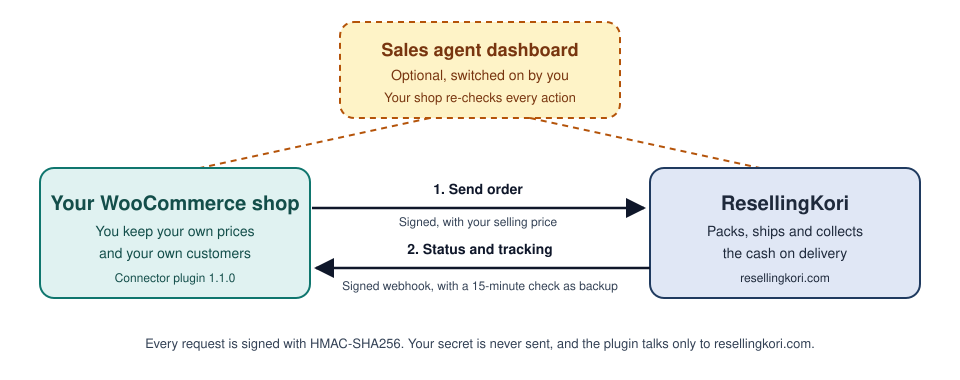
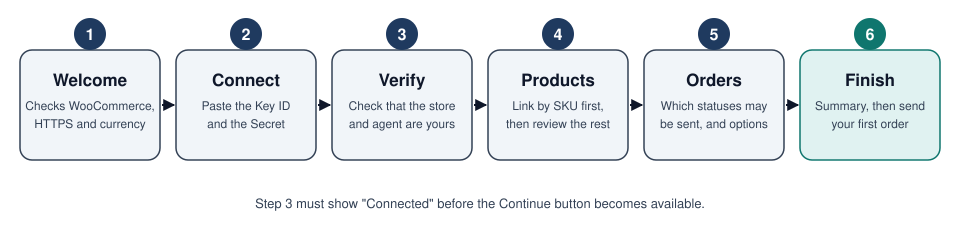
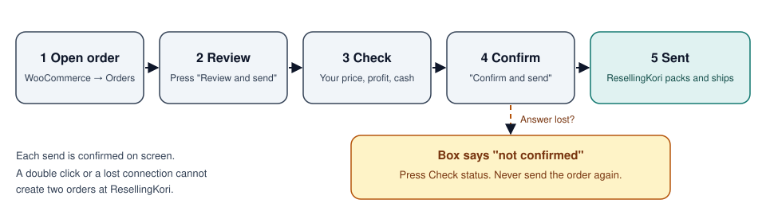
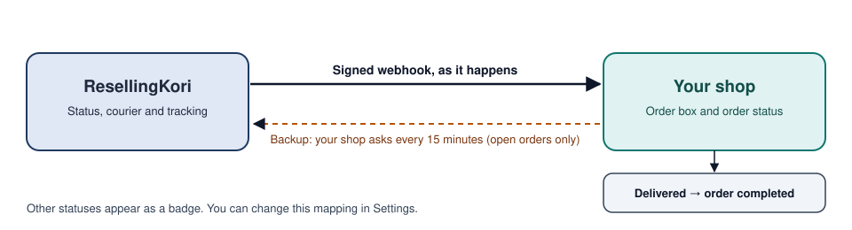

# ResellingKori Fulfillment Connector

Connect your WooCommerce shop to **resellingkori.com**. You keep selling at your own prices. ResellingKori packs and ships the order to your customer, and the status and tracking number come back to your shop by themselves.

| | |
|---|---|
| **Version** | 1.2.0 |
| **Licence** | GPL-2.0-or-later (see `license.txt`) |
| **Requires** | WordPress 6.0+ · WooCommerce 7.0+ (High-Performance Order Storage and legacy storage) · PHP 7.4+ with the **sodium** extension (8.1+ recommended) |
| **Currency** | Orders are sent in **BDT (৳)** only |
| **Languages** | English, and a Bangla quick guide in `docs/RESELLER_SETUP.md` |

## What it does

| You want to… | The connector… |
|---|---|
| Know which of your products ResellingKori sells | Matches them **by exact SKU first**. For products without a SKU it suggests ResellingKori products from the **product-name keywords**. You can also search by hand. Nothing is linked from a *suggestion* until you click. |
| Sell above ResellingKori's price | Sends **your selling price** with the order. ResellingKori records it as the SalesKing *set price* next to its own *original price*, so your agent dashboard and commission work exactly like an order the agent placed by hand. ResellingKori's own price always comes from ResellingKori. It cannot be changed from your side. |
| Ship an order that contains products from other suppliers too | If **some** items of an order are not linked, a "send only the ResellingKori items" choice appears, and only then. The rest of the order stays yours, and your order status is never changed by a partial shipment. |
| Be sure an order is never sent twice | Every send is reviewed and confirmed on screen. A double click, two staff members, a lost internet connection or a crash cannot create two orders at ResellingKori. If the answer gets lost, the connector **asks** ResellingKori instead of guessing. |
| Follow the delivery | Status, courier and tracking number arrive by signed webhook, with a check every 15 minutes for orders that are still open as a backup. They show in the ResellingKori box on the order and, if you choose, change your order's status. |
| Fix a mistake | **Cancel** the order at ResellingKori while it has not been processed, correct your order, and **send it again**. |
| Let your sales agent work from the ResellingKori dashboard *(optional, new in 1.1.0)* | When you switch it on, your agent sees this shop's ResellingKori orders on a separate **ResellingKori** page in the agent dashboard, with ResellingKori's price next to yours. The agent can send, cancel, check and link from there. Your shop does the work itself and re-checks everything first. Nothing is collected until you say yes. |
| Add ResellingKori products from the dashboard *(new in 1.2.0)* | Your agent picks products in the dashboard's **Add products** tab and sets your selling price; your shop creates them published and already linked, with descriptions, SKU, categories and pictures. Prices below ResellingKori's price, duplicates and SKUs you already use are refused. |
| Stock monitor *(new in 1.2.0)* | Per product: when ResellingKori runs out, the product goes out of stock in your shop, and comes back when ResellingKori has it again. The dashboard lists recently out-of-stock linked products first. |

## Quick start

1. Get a **Key ID** (starts with `rkk_`) and a **Secret** (starts with `rks_`) from ResellingKori. The secret is shown only once.
2. In WordPress go to *Plugins → Add New → Upload Plugin*, choose the ZIP, press **Install Now** and then **Activate**.
3. Open **WooCommerce → ResellingKori** and follow the six-step set-up guide.

Step 3 must show **Connected** with your own store name and sales agent before you continue. The full guide is in `docs/INSTALLATION.md`.

## Sending an order

Open the order in WooCommerce. The **ResellingKori** box shows every item with its ResellingKori price and your profit or loss, the delivery charge you may change, what the customer has already paid, the **cash the courier will collect**, and the delivery address.

Press **Review and send**, read the summary, then press **Confirm and send to ResellingKori**. If prices, stock or the order changed in the meantime, the connector tells you and asks you to review again. If the answer gets lost, the box says **"not confirmed"**. Press **Check status** and never send the order again. Step-by-step instructions are in `docs/RESELLER_SETUP.md`.

## Status updates

By default only **Delivered** completes your order. Other statuses appear as a badge, and you can change that mapping under *Settings*.

## Security

Every request is signed with HMAC-SHA256 using your secret. The secret itself is **never sent**, never put in a URL, a page, a log or an e-mail, and is stored encrypted. ResellingKori decides which shop and which agent a request belongs to from the key, never from anything in the request. Replays and old requests are rejected, and webhooks are verified the same way. Read `docs/SECURITY.md` for the details and the limits.

## Privacy

When you send an order, the following goes to ResellingKori: the items (ResellingKori product ID, SKU, name, quantity and **your** selling price), the recipient's **name, phone number and delivery address**, the **e-mail** if the order has one, the order note, the payment figures, and your store's order number. Nothing else leaves your shop. There is no telemetry, no analytics and no remote scripts or fonts.

If you switch on the agent dashboard, the shop also reports a short summary. It holds the order number, status, items and amounts, the recipient's name and city, and a partly hidden phone number. It never holds the e-mail, the street address or the full phone number. Switching the dashboard off deletes that summary at ResellingKori. The full field list and retention periods are in `docs/PRIVACY.md`.

## Requirements checklist

* HTTPS on your shop. This is strongly recommended. Without it, the connector still works and checks ResellingKori every 15 minutes instead of receiving live updates.
* A real cron job that runs every minute, if you use the agent dashboard. See *Scheduled tasks* in `docs/INSTALLATION.md`.
* Pretty permalinks (*Settings → Permalinks → Post name*) are recommended.

## Where to find things

| | |
|---|---|
| Dashboard, setup, products, orders, logs and settings | WooCommerce → ResellingKori (tabs) |
| Each order | The **ResellingKori** box on the order screen |
| Logs and diagnostics | WooCommerce → ResellingKori → Logs & diagnostics. Secrets are never written, and e-mail addresses and phone numbers are masked. |
| Agent dashboard (optional) | WooCommerce → ResellingKori → Settings → ResellingKori agent dashboard |

## Permissions

Administrators can do everything. Shop managers can link products, send and cancel orders, and see ResellingKori information on orders. They cannot see the logs, the settings or the credentials. Six capabilities control access: `rkc_manage_connection`, `rkc_manage_credentials`, `rkc_manage_mapping`, `rkc_submit_orders`, `rkc_view_orders` and `rkc_view_logs`. Having WooCommerce's `manage_woocommerce` is **not** enough on its own. Switching the agent dashboard on or off needs `rkc_manage_connection`.

## Documentation

| File | Read it for |
|---|---|
| `docs/INSTALLATION.md` | Requirements, installing, upgrading, and checking an installation |
| `docs/RESELLER_SETUP.md` | Day-to-day use: linking products, sending, cancelling, and the Bangla quick guide |
| `docs/AGENT_GUIDE.md` | The sales agent's view of the ResellingKori dashboard page |
| `docs/TROUBLESHOOTING.md` | Every message the plugin shows, and what to do about it |
| `docs/SECURITY.md` | What the plugin protects, what you must do, and what no plugin can protect |
| `docs/PRIVACY.md` | Exactly what leaves your shop, retention, and the personal-data tools |
| `docs/CHANGELOG.md` | Version history |

## Uninstalling

Deactivating keeps everything. Deleting the plugin keeps your product links and order history, unless you tick **Delete all plugin data (links, submission records, logs) when the plugin is deleted** in *Settings*. Your key and secret are always erased on delete. If you used the agent dashboard, switch it off first so that ResellingKori deletes what it holds. Deleting the plugin does not contact ResellingKori.

## Support

Send the diagnostics text from *Logs & diagnostics* to ResellingKori support. It never contains your secret. To report a security problem, contact ResellingKori privately, as described in `docs/SECURITY.md`.
