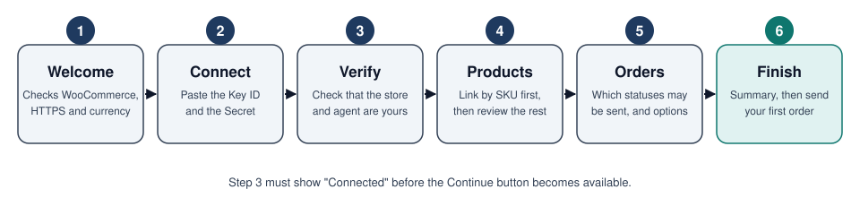

# Installation

This plug-in, the **ResellingKori Fulfillment Connector** (`resellingkori-connector-v1.1.0.zip`), is installed on your WooCommerce shop (for example `example.com`). It lets you send orders to ResellingKori at your own selling prices, and (if you choose) lets you do the same from your ResellingKori agent dashboard. It contains no private server code and no secrets.

**Upgrading from v1.0.0?** Install this ZIP over the old one (*Plugins → Add New → Upload Plugin → Replace current with uploaded*). Your settings, links and history are kept and nothing changes until you decide: a notice **"New: use your ResellingKori agent dashboard for this shop"** appears for administrators with the buttons *Turn on* and *Not now*. **Until you press *Turn on*, nothing about your orders is collected or sent for the dashboard.** The notice explains exactly what would be shared (see `PRIVACY.md`).

**Upgrading from v0.2.0?** Version 0.2.0 and version 1.x cannot talk to each other, so ResellingKori upgrades its side at the same time and tells you the day. Install this ZIP over the old one when you are told (*Replace current with uploaded*), then press *Verify connection* once. See the migration note in `CHANGELOG.md`.

## Requirements (Connector – your shop)

| | |
|---|---|
| WordPress | 6.0 or newer |
| PHP | 7.4 or newer (8.1+ recommended) with the **sodium** extension |
| WooCommerce | 7.0 or newer; High-Performance Order Storage or legacy order storage |
| Store currency | **BDT** (ResellingKori accepts BDT only) |
| Network | your shop may call `https://resellingkori.com` (this is all the plug-in ever contacts; the agent dashboard uses the same connection). HTTPS on your shop is strongly recommended so that ResellingKori can reach `…/wp-json/rkc/v1/webhook` (without it the shop checks for updates every 15 minutes instead) |
| Scheduled tasks | WordPress' scheduler (WP-Cron) must run. On a quiet shop ask your host for a real cron job that runs every minute (see *Scheduled tasks* below). The agent dashboard responds within about a minute only when the scheduler runs about once a minute |

The plug-in declares compatibility with High-Performance Order Storage. This release was tested with PHP 8.3, WordPress 7.1 and WooCommerce 11.2 in both storage modes; other versions within the ranges above are expected to work but were not tested.

## Installing the Connector (reseller)

You need: administrator access to your WordPress, the **Key ID** (starts with `rkk_`) and the **Secret** (starts with `rks_`) that ResellingKori issued to you. The secret is shown to ResellingKori staff only once; if you lost it, ask them for a new key.

1. Make sure **WooCommerce is installed and active**.
2. *Plugins → Add New → Upload Plugin* → choose `resellingkori-connector-v1.1.0.zip` → **Install Now** → **Activate**.
3. Open **WooCommerce → ResellingKori** (if your role cannot open the WooCommerce menu, the same page appears as a top-level **ResellingKori** item).
4. The setup guide has six steps:
   1. **Welcome** – checks WooCommerce, the encryption extension, HTTPS and the BDT currency. Fix any "!" mark if you can.
   2. **Connect** – type the Key ID and the Secret. The secret is encrypted before it is saved and is never shown again.
   3. **Verify** – press *Verify connection*. The page shows the **store name and the sales agent** your key belongs to. Check that they are yours.
   4. **Products** – press *Match all by SKU now*. Products with the same SKU are linked automatically; the rest can be linked later from the *Products* tab (or from your agent dashboard), where the plug-in suggests ResellingKori products with similar names and you decide.
   5. **Orders** – preferences (which order statuses may be sent, which payment methods mean cash on delivery, what happens after sending) and the choice **"Show this shop's ResellingKori orders and products in my ResellingKori agent dashboard"**. The box is **already ticked** because it is the recommended choice, and the text above it says exactly what is shared. It only takes effect when you press *Save and continue*. **Untick it if you do not want the dashboard**; you can change your mind later under *Settings*.
   6. **Finish** – a summary and how to send an order.
5. Send a first order by hand (see `RESELLER_SETUP.md`).



**Who can do what.** Administrators can do everything. Shop managers can link products, view orders and send them (they cannot see or change the key or the dashboard switch). Other roles can be given the individual capabilities `rkc_manage_connection`, `rkc_manage_credentials`, `rkc_manage_mapping`, `rkc_submit_orders`, `rkc_view_orders`, `rkc_view_logs` with a role editor. Switching the agent dashboard on or off needs `rkc_manage_connection`.

**Optional hardening.** Add to `wp-config.php` (above the line *That's all, stop editing!*) a private encryption key for the stored secret, **before** you save the key in step 2:

```php
define( 'RKC_ENCRYPTION_KEY', '<at least 32 random characters>' );
```

Without it the plug-in derives a key from your WordPress salts. Do not change either value later: a changed key or changed salts make the saved secret unreadable and you would need to enter the Key ID and Secret again.

**Updating.** *Plugins → Add New → Upload Plugin* → the new ZIP → **Replace current with uploaded**. Settings, links and history are kept.

**Removing.** *Deactivate* changes nothing. *Delete* always erases your key and secret, the scheduled jobs and the agent-dashboard state; your links, history and settings stay unless *Settings → Delete all plugin data (links, submission records, logs) when the plugin is deleted* was ticked. Orders are never deleted. **If you used the agent dashboard, first switch it off** (*Settings → ResellingKori agent dashboard*): switching it off tells ResellingKori to delete everything it holds from your shop at once. Deactivating or deleting the plug-in does not contact ResellingKori, so without that step the data simply expires there after the retention period stated in `PRIVACY.md`.

## Scheduled tasks (recommended for the agent dashboard)

The shop looks for new instructions from the agent dashboard, and reports changes, about once a minute. WordPress runs such tasks when somebody visits the shop; on a quiet shop that can be minutes late. Two things make it prompt:

* Your agent's browser **nudges** the shop the moment the agent presses a button in the dashboard (nothing is sent through the browser except a signed "please look now" request). This needs no setup beyond the address for live status updates being verified (the Connector shows "Live status updates are active" when it is), but some firewalls block it; then the shop falls back to the schedule below.
* A **real cron job** (recommended): ask your host to run `wp cron event run --due-now` every minute, or to call `https://<your-shop>/wp-cron.php?doing_wp_cron` every minute, and set `define( 'DISABLE_WP_CRON', true );` in `wp-config.php` only if the real job exists.

The order boxes, linking, sending and status updates described in `RESELLER_SETUP.md` work with or without the dashboard.

## Permalinks

Pretty permalinks (*Settings → Permalinks → Post name*) are recommended. With "Plain" permalinks the plug-in still works (it accepts `?rest_route=/…` addresses), but some security plug-ins and firewalls block that form. If you see 404 or 403 on `/wp-json/…`, see `TROUBLESHOOTING.md`.

## Verifying an installation

**Connector**

| Check | Expected |
|---|---|
| *Setup → Verify connection* | "Connected", with the right store and agent |
| *Settings → Connection → Webhook address* | shows `https://<your-shop>/wp-json/rkc/v1/webhook`; after verification "Live status updates are active" appears on the last step |
| First order | send one cheap order, check it with ResellingKori, then cancel it from the order box |
| *Settings → ResellingKori agent dashboard* (only if you switched it on) | a green **Working** badge and "Working. Last synced … ago." within a few minutes. **Waiting** with "ResellingKori has not switched the agent dashboard on for stores yet" means the shop side is ready and ResellingKori's side is not; nothing is wrong with your shop (see `TROUBLESHOOTING.md`) |
| Your agent dashboard at ResellingKori | a menu entry named **ResellingKori** (it appears for agents whose shop has connected) with your orders and products |
